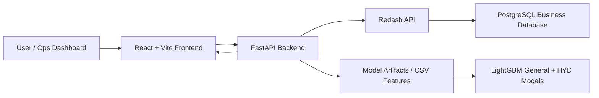
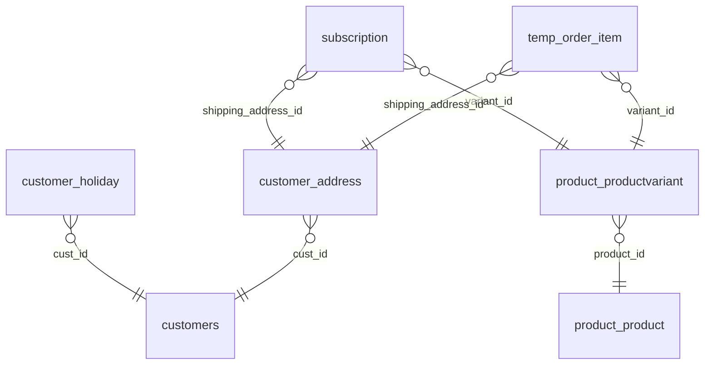

# Milk Demand Forecasting System - Complete Project Documentation

Last updated: 2026-06-16  
Repository root: `D:\ML_Forecasting_Model`

## 1. Executive Summary

The Milk Demand Forecasting System is a production-oriented forecasting application for daily packet demand planning. It combines deterministic live demand from Redash/PostgreSQL with machine learning forecasts from LightGBM models and exposes the result through a FastAPI backend and a React dashboard.

The business problem is procurement planning for perishable dairy products. Milk and curd demand must be estimated before the operational cutoff, but customer behavior can change between procurement planning time and final delivery cutoff. Under-forecasting causes shortages and customer failures; over-forecasting causes wastage.

The system currently focuses on daily packet quantities for four cities:

- `HYD` - Hyderabad, highest business priority
- `BLR` - Bengaluru
- `PNQ` - Pune
- `VGA` - Vijayawada

Priority products are:

- A2 Buffalo Milk
- A2 Desi Cow Milk
- Cow Milk
- Double Toned A2 Buffalo Milk
- Skim Milk
- Toned Milk
- Curd

The target users are procurement planners, operations managers, analysts, and developers maintaining the forecasting workflow.

The current serving formula is:

```text
Final Forecast = Live Subscription Qty + Known Buy Once Qty + ML Procurement Gap
```

For the current `procurement_final_total` model target, the ML model predicts final total demand. The backend then computes:

```text
ML Procurement Gap = max(0, model_final_total_prediction - live_known_total)
live_known_total = subscription_qty + known_buy_once_qty
```

This design was chosen because live subscriptions and already placed buy-once orders are deterministic signals and should never be overwritten by ML. ML is used only for demand not already visible in live systems.

## 2. System Architecture

### High-Level Architecture



### Why This Architecture

The system separates deterministic known demand from model-based uncertainty. Redash is used as the data access layer because the team cannot directly create database tables or materialized views in production. Local CSV/model artifacts are used for training and serving because the current development workflow is file-based and easy to run from Windows PowerShell.

### Frontend Architecture

Frontend code lives under `frontend/`.

The UI is a single-page React dashboard built with Vite. It does not currently use React Router. State is managed locally in `frontend/src/App.jsx` through React hooks:

- `useState` for selected date, active tab, filters, pagination, and loading/error states
- `useEffect` for loading forecasts and trends
- `useCallback` for API fetch functions

Charts are rendered with `recharts`.

### Backend Architecture

Backend code lives under `backend/`.

The backend is a single FastAPI module:

- `backend/main.py`

It performs:

- Environment loading
- Model artifact loading
- Redash API calls
- Data normalization
- Feature construction
- LightGBM inference
- Forecast aggregation
- Debug diagnostics

This is compact and easy to run locally, but it also means controller, service, and repository responsibilities are currently combined in one file. That is acceptable for a prototype, but it is technical debt for a production service.

### Database Architecture

The backend does not connect directly to PostgreSQL. It calls Redash query APIs. The SQL files in `redash_queries/` reference PostgreSQL tables including:

- `subscription`
- `customer_holiday`
- `customers`
- `customer_address`
- `temp_order_item`
- `product_productvariant`
- `product_product`
- `d2c_order_newfact`
- `order_item` and `"order"` in diagnostic queries

Because database DDL is not present in the repository, schemas are inferred from SQL and screenshots shared during development. This documentation avoids claiming constraints or indexes that are not visible in code.

### Third-Party Integrations

- Redash API: live data access and training exports
- PostgreSQL: source database behind Redash
- LightGBM: model training and inference
- React/Vite/Recharts: frontend dashboard
- FastAPI/httpx: API serving and Redash calls

### Authentication Flow

There is no user login/signup flow in the frontend or backend. Backend access control is limited:

- Redash API access uses `QUERY_API_KEY` from environment variables.
- `/api/debug/components` can optionally require `ADMIN_TOKEN` using `x-admin-token`.
- CORS origins are configurable through `CORS_ORIGINS`.

This means application-level authentication is not production-grade yet.

### Deployment Architecture

Current deployment is local/dev-server oriented:

- Backend: `uvicorn main:app --reload --host 127.0.0.1 --port 8000`
- Frontend: `npm run dev` on Vite
- Model files are loaded from `backend/ml_models/`
- Training scripts are run manually from `ml_pipeline/`

No CI/CD, containerization, cloud deployment, or process supervisor configuration is present in the repository.

## 3. Frontend Documentation

### Technology Stack

Location: `frontend/`

- React `19.2.5`
- React DOM `19.2.5`
- Vite `8.0.10`
- ESLint
- Native `fetch` for API calls

### Folder Structure

```text
frontend/
  index.html
  package.json
  vite.config.js
  src/
    main.jsx
    App.jsx
    App.css
    index.css
    api.js
  public/
    sids-farm-logo.png
```

The active operational dashboard is implemented in `frontend/src/App.jsx`.

### `frontend/src/api.js`

Purpose: centralizes backend API calls.

```js
const API = "http://localhost:8000/api";
```

Functions:

- `getOperationalForecast(asOfDate, refresh)` calls `GET /api/operational_forecast`
- `getStatus()` calls `GET /api/status`

Important limitation: `API` is hardcoded to localhost. For production, this should use Vite environment variables.

### `frontend/src/App.jsx`

Purpose: complete dashboard UI.

Major state:

- `data`: forecast response
- `systemStatus`: training and festival-calendar status
- `loading`, `error`
- `cityFilter`, `productFilter`, `search`
- `showComponents`: controls component columns in the table

User flow:

1. User opens dashboard.
2. Issue date defaults to the current India date unless `?as_of=` is present.
3. The dashboard requests the operational D-2/D-3 forecast and system status.
4. KPI totals, city cards, the procurement table, and festival events update.
5. User can change quick-date buttons, date input, city filter, product filter, tab, or trend range.

Main dashboard features:

- KPI row:
  - Total Forecast
  - Subscription
  - Known Buy Once
  - ML Procurement Gap
  - Coverage
- City cards
- Product table with subscription, known buy-once, ML gap, total forecast, and orders
- Recharts city/product/trend charts
- Trend tab based on cached backend forecast rows

Error handling:

- If backend returns 404, frontend shows a recoverable message.
- Other fetch failures show a backend connectivity message.

Hidden assumptions:

- Backend is running on `localhost:8000`.
- Response schema contains `meta`, `city_summary`, and `product_breakdown`.
- Product and city names are already normalized by backend.

## 4. Backend Documentation

### Technology Stack

Location: `backend/`

- FastAPI
- Uvicorn
- pandas
- NumPy
- LightGBM
- scikit-learn label encoders stored in pickle artifacts
- httpx for async Redash calls

Dependencies are listed in `backend/requirements.txt`.

### Backend Runtime Files

```text
backend/
  main.py
  requirements.txt
  ml_models/
    lgbm_model.pkl
    lgbm_model_hyd.pkl
    training_clean.csv
    training_filled.csv
    training_features.csv
    test_predictions.csv
    procurement_plan.csv
    festival_list_2024_2026.csv
```

### Environment Variables

Loaded from root `.env` and `backend/.env` by `_load_env_files()` in `backend/main.py`.

Important variables:

- `REDASH_BASE_URL`
- `QUERY_API_KEY`
- `SUBSCRIPTION_QUERY_ID`
- `KNOWN_BUY_ONCE_QUERY_ID`
- `RECENT_ACTUALS_QUERY_ID`
- `ADMIN_TOKEN`
- `CORS_ORIGINS`

Security note: Redash credentials must remain out of source control.

### Startup Flow

`backend/main.py` performs startup work at import time:

1. Loads environment variables.
2. Creates FastAPI app and CORS middleware.
3. Loads general model from `lgbm_model.pkl`.
4. Loads HYD model from `lgbm_model_hyd.pkl`.
5. Derives feature order from model artifacts.
6. Loads procurement plan.
7. Loads training history for lag fallback.
8. Builds day-of-week ratio lookups.
9. Loads festival calendar.

This makes serving fast after startup, but startup will fail if model artifacts are missing.

### API Documentation

#### `GET /`

Purpose: basic liveness message.

Response:

```json
{"message": "API is running"}
```

#### `GET /health`

Purpose: operational health and model/query metadata.

Response includes:

- `status`
- `model`
- `model_target_type`
- `hyd_model_target_type`
- Redash query IDs

No authorization is required.

#### `GET /api/status`

Purpose: tells whether forecast rows are cached.

Response:

```json
{
  "cached": true,
  "generated_at": "..."
}
```

#### `GET /api/forecast_day?date=YYYY-MM-DD&refresh=false`

Purpose: main forecast endpoint.

Flow:

1. Parse date through `_parse_forecast_date`.
2. Fetch subscription data from Redash query `SUBSCRIPTION_QUERY_ID`.
3. Fetch known buy-once data from `KNOWN_BUY_ONCE_QUERY_ID`.
4. Fetch recent actuals from `RECENT_ACTUALS_QUERY_ID`.
5. Build model features and generate LightGBM predictions.
6. Aggregate rows into metadata, city summary, and product breakdown.
7. Cache the day rows for trend endpoint.

Response shape:

```json
{
  "meta": {
    "order_date": "2026-06-16",
    "total_quantity": 0,
    "subscription_qty": 0,
    "known_buy_once_qty": 0,
    "ml_unknown_adhoc_qty": 0
  },
  "city_summary": [],
  "product_breakdown": []
}
```

Business logic:

For `procurement_final_total`, ML predicts total final demand. Backend subtracts live known demand to produce only the remaining procurement gap:

```python
unknown_ad_hoc_qty = max(0, final_ad_hoc_pred - live_known_total)
```

Why: known subscriptions and placed buy-once orders should form a floor. ML should not reduce already visible demand.

#### `GET /api/forecast_raw?refresh=false`

Purpose: raw forecast rows for export/debug.

If no cache exists or `refresh=true`, it computes 30 days starting from tomorrow.

#### `GET /api/forecast_trend?days=14`

Purpose: aggregates cached forecast rows into daily totals.

Limitation: if no forecast has been run and cache is empty, trend returns an empty list.

#### `GET /api/debug/components?date=YYYY-MM-DD&refresh=false`

Purpose: detailed diagnostics for debugging forecast composition.

Optional auth:

- If `ADMIN_TOKEN` is set, request must provide `x-admin-token`.

Response includes:

- component input row counts
- HYD priority product breakdown
- HYD model diagnostics
- raw component rows

This endpoint is essential for verifying training-serving parity and component errors.

### Internal Backend Functions

#### `_fetch_redash_rows`

Calls Redash API asynchronously. It supports direct query results and asynchronous Redash jobs. Results are cached by:

```text
(cache_key, query_id, target_date)
```

Cache TTL is one hour unless `force_refresh` is used.

#### `_process_quantity_rows`

Normalizes Redash row output:

- city normalization
- product normalization
- quantity column selection
- order count handling
- filtering junk/test/sample products
- aggregation to city/product

#### `_get_lag_features`

Builds lag and rolling features from:

1. Recent actuals from Redash, if available
2. Future predicted rows when forecasting beyond the latest training date
3. Local training CSV history
4. Fallback value

This reduces stale-lag risk for live inference.

#### `_guarded_model_prediction`

Applies a recent-actual baseline fallback if the model prediction collapses unrealistically below recent demand.

#### `_apply_procurement_calibration`

Applies validation-derived city/product calibration factors embedded in model artifacts.

## 5. Database Documentation

Database access is through Redash SQL, not direct backend connections.

### Inferred Tables

#### `subscription`

Used by `redash_queries/subscription_forecast.sql`.

Inferred fields:

- `cust_id`
- `shipping_address_id`
- `variant_id`
- `subscription_type`
- `subscription_status`
- `is_daily`
- `is_alt_day_sub`
- `is_paused`
- `pause_start_date`
- `pause_end_date`
- `valid_from`
- `valid_upto`
- `start_date`
- `start_day_qty`
- `next_day_qty`
- weekday columns: `sun`, `mon`, `tue`, `wed`, `thu`, `fri`, `sat`
- JSON field `data`

Purpose: deterministic subscription quantity calculation.

Important logic:

- active subscriptions only
- holidays removed
- paused subscriptions removed
- validity window respected
- daily/alternate/custom schedules handled

#### `customer_holiday`

Used to suppress subscriptions when customer holiday period covers target date.

Fields inferred:

- `cust_id`
- `valid_from`
- `valid_upto`
- `is_deleted`

#### `customers`

Used for wallet suppression.

Fields inferred:

- `id`
- `wallet_type`
- `current_balance`

#### `customer_address`

Used for city attribution.

Fields inferred:

- `id`
- `cust_id`
- `city_cd`
- `is_active`
- `updated_at`

Design choice: shipping address is preferred. Latest active customer address is fallback.

#### `temp_order_item`

Used for known buy-once and snapshot rows.

Fields inferred:

- `order_date`
- `created_at`
- `customer_id`
- `shipping_address_id`
- `variant_id`
- `purchase_type`
- `status`
- `quantity`
- `free_product`

Important assumption: `order_date` is used as planned delivery date in staging/snapshot logic.

#### `product_productvariant` and `product_product`

Used to map variant IDs to product names.

Fields inferred:

- `product_productvariant.id`
- `product_productvariant.product_id`
- `product_productvariant.price_override_amount`
- `product_product.id`
- `product_product.name`

#### `d2c_order_newfact`

Used by final actual training queries.

Fields inferred:

- `delivery_date`
- `customer_city`
- `product_name`
- `purchase_type`
- `status`
- `order_volume`
- `customer_id`

This fact table matched business dashboard scale better than raw `order_item` joins during analysis.

### ERD Explanation



The actual database may contain additional constraints and relationships not visible in this repository.

## 6. Models and AI Logic

There are no LLMs, prompts, temperatures, or generative AI workflows in this project. The "AI" component is classical machine learning.

### General LightGBM Model

Artifact:

- `backend/ml_models/lgbm_model.pkl`

Training script:

- `ml_pipeline/train_general_lgbm.py`

Purpose:

- Predict total final procurement demand or legacy ad-hoc demand for city/product/date series across all supported cities.

Inputs:

- Encoded city/product/city-product
- Calendar features
- Lag features
- Rolling windows
- Festival features
- Quantity-per-order
- Trend/slope features
- Snapshot visible demand features if present

Output:

- Predicted packet quantity

Target:

- `procurement_final_total` when training CSV contains `final_subscription_qty` and `final_buy_once_qty`

Objective:

- Tweedie for non-residual final-total model
- L1 regression for residual model

Why LightGBM:

- Handles nonlinear tabular time-series features well
- Fast to train locally
- Works with mixed calendar, lag, product, and city features
- Easier to operate than deep learning for the current dataset size

Alternative models considered:

- XGBoost/CatBoost: viable, but no clear reason to replace LightGBM yet
- Prophet/SARIMA: weaker for many city-product SKU series with exogenous live-known demand
- Random Forest: less efficient and weaker extrapolation
- TFT/N-BEATS/DeepAR: require more data, more infrastructure, and stronger MLOps

### HYD-Specific LightGBM Model

Artifact:

- `backend/ml_models/lgbm_model_hyd.pkl`

Training script:

- `ml_pipeline/train_hyd_lgbm.py`

Purpose:

- Specialized model for Hyderabad priority demand.

Why separate HYD model:

- HYD is the top business priority.
- HYD has different volume, product mix, and weekday behavior.
- A city-specific model can use product-level patterns without cross-city noise.

Objective:

- Quantile objective with `alpha=0.60` for final-total procurement target.

This slightly biases predictions upward, which is reasonable for procurement where underprediction is often worse than small overprediction.

### Calibration Logic

Both training scripts compute validation-derived calibration factors:

```text
factor = validation_actual_sum / validation_pred_sum
factor clipped to [0.90, 1.10]
```

General model stores factors by `(city, product)`.

HYD model stores factors by `product_name`.

Backend applies calibration only for `procurement_final_total` target models.

## 7. Business Logic Deep Dive

### Forecast Composition

The system decomposes demand into:

1. Subscription forecast
2. Known buy-once
3. ML procurement gap

This avoids the previous architectural mistake of subtracting subscriptions from ML demand incorrectly. The current architecture treats deterministic known demand as a floor.

### Subscription Logic

SQL file:

- `redash_queries/subscription_forecast.sql`

Major rules:

- `subscription_status = active`
- not paused
- within `valid_from` and `valid_upto`
- customer holiday excluded
- wallet suppression applied by comparing prepaid wallet balance to total order value
- daily, alternate, and custom subscriptions are computed separately

Edge cases:

- Missing quantity fields fallback to zero
- Alternate subscriptions require valid anchor date
- Custom subscriptions can use weekday columns or JSON fields

### Known Buy Once Logic

SQL file:

- `redash_queries/known_buy_once.sql`

Purpose:

- Count already placed buy-once demand for a delivery date.

Important filters:

- `order_date = target_date`
- `created_at <= D-1 22:00 IST`
- status in `DRAFT`, `PROCESSED_TO_ORDER`
- `free_product = false`
- purchase type buy-once-like

Why include `DRAFT`: future delivery orders can remain in draft before processing, but they are still visible known demand.

### Recent Actuals Logic

SQL file:

- `redash_queries/recent_final_total_actuals.sql`

Purpose:

- Provides recent final total demand for lag features in live inference.

This is required for `procurement_final_total` models. Using ad-hoc-only recent actuals would create feature skew.

### Procurement horizons

The dashboard applies the operational horizon policy directly:

- HYD/VGA: D-2
- BLR/PNQ: D-3

The abandoned approximate snapshot-training SQL was removed. Audit-grade
historical evaluation still requires forecasts to be stored immutably when
they are issued; a current-state table cannot reconstruct an old cutoff.

## 8. Authentication & Authorization

The project currently has no frontend login, signup, sessions, refresh tokens, or role-based access control.

Existing protection:

- Redash API key is environment-based.
- Optional `ADMIN_TOKEN` can protect debug component endpoint.
- CORS is restricted by `CORS_ORIGINS`, defaulting to local Vite origins.

Risks:

- Forecast endpoints are public if the backend is exposed.
- Debug endpoint can leak business-sensitive aggregate data if `ADMIN_TOKEN` is not configured.
- No rate limiting.
- No request audit logging.

Recommended production approach:

- Put backend behind company SSO or an authenticated internal gateway.
- Require auth for all forecast endpoints.
- Use role-based authorization for debug and export endpoints.
- Store secrets in a secret manager.

## 9. Error Handling Strategy

### Frontend

Frontend catches API errors in `App.jsx`:

- 404 shows a "try again" message
- Other errors show backend connectivity guidance

Limitations:

- No retry/backoff
- No structured error codes
- No user-visible Redash data freshness status

### Backend

Backend handles:

- Invalid date format with HTTP 400
- Empty day forecast with HTTP 404
- Redash failures by logging and returning empty dataframes
- Missing query IDs by returning empty known/recent data

The Redash fallback behavior prevents API crashes, but it can silently degrade forecast quality. This is useful for availability but risky for procurement decisions.

Recommended improvement:

- Include component freshness and failure flags in response metadata.
- Surface Redash failures to frontend.
- Emit structured logs and metrics.

## 10. Performance Optimizations

### Backend

Implemented:

- Redash response cache for one hour
- Async Redash HTTP calls
- `run_in_threadpool` for CPU/dataframe work
- Models and training data loaded once at startup
- Feature order derived from LightGBM artifact

Trade-off:

- Caching improves speed but can show stale live demand unless `refresh=true`.

### Frontend

Implemented:

- Single API call per date
- Client-side filtering and pagination
- Recharts responsive containers

Limitations:

- The dashboard is monolithic.
- No memoization for large product tables beyond simple filtering.

### Database/Redash

Optimizations:

- Final actuals now use `order_item` joined to `"order".expected_delivery_date`, aligned with the business D2C dashboard definition.
- Redash query output is aggregated before reaching backend.

Risks:

- Large Redash queries can timeout.
- Redash is not ideal as a serving dependency.

## 11. Issues Faced During Development

### Missing Redash API Key

Symptom:

```text
QUERY_API_KEY environment variable is not configured
```

Impact:

- Subscription demand became zero.
- Forecast became ML-only.

Solution:

- Environment loading from `.env` and `backend/.env`.
- Clear warning when Redash key missing.

### Subscription Subtraction Bug

Old issue:

```text
ML Forecast - Subscription Forecast
```

This drove ML forecasts toward zero or negative values.

Corrected design:

```text
Subscription + Known Buy Once + ML Gap
```

### Training-Serving Skew

Issue:

- `qty_per_order` differed between training and serving.

Fix:

- Serving computes it from lag-1 quantity in feature builder.

### Missing Lags

Issue:

- Missing lags were previously defaulted to subscription demand.

Fix:

- Missing lags default to zero or recent actuals/training history as available.

### Wrong Target Design

Issue:

- Residual unknown ad-hoc after cutoff was often zero and did not match procurement planning.

Solution:

- Shift to procurement final-total target using final confirmed packet demand.

### Redash Recent Actuals Mismatch

Issue:

- Final-total model used ad-hoc-only recent actuals at one point.

Fix:

- `recent_final_total_actuals.sql` provides subscription + buy-once final total actuals.

### Final Actual Source Mismatch

Issue:

- Earlier final-total queries used `d2c_order_newfact`, but the team dashboard actuals are based on `order_item` joined to `"order".expected_delivery_date`.

Fix:

- Use Redash Query 1968 as the official comparison source, and align
  `recent_final_total_actuals.sql` plus `procurement_final_total_training.sql`
  with that gross-demand definition.

### Product Mapping Gaps

Issue:

- `Toned Milk` normalization missing in live queries.

Fix:

- Added `toned_milk` / `toned milk` mapping in Redash subscription and known buy-once queries.

## 12. Improvement Opportunities

### Frontend

Priority: Medium

- Split `App.jsx` into reusable components.
- Move API base URL into Vite env.
- Add component freshness indicators.
- Add debug/diagnostic panel for authorized users.

### Backend

Priority: High

- Split `main.py` into routers, services, clients, and model modules.
- Add structured logging.
- Add response-level data freshness metadata.
- Add auth to all endpoints.
- Add typed Pydantic response models.

### Data/MLOps

Priority: High

- Create true historical snapshot table or order status audit feed.
- Store model metadata and metrics with each artifact.
- Add automated backtesting and walk-forward validation.
- Add model registry/versioning.
- Add scheduled retraining.

### Forecasting

Priority: High

- Train final model on exact procurement snapshot state.
- Separate main HYD milk products from long-tail products.
- Add business event calendar once confirmed.
- Evaluate conformal or quantile prediction intervals.

### Security

Priority: High

- Remove any hardcoded/semi-static secrets from local files.
- Use secret manager.
- Add authentication.
- Add rate limits.
- Restrict debug endpoints.

### Scalability

Priority: Medium

- Replace Redash serving dependency with a scheduled ETL feature store when database permissions allow.
- Add Redis or persistent cache for live known demand.
- Run backend behind a process manager/container.

## 13. Future Enhancements

### Upcoming Festival Module

Status: placeholder only. Do not implement until business confirms festival impact rules.

Potential architecture:

```text
festival_calendar table/CSV
    date
    city
    festival_name
    impact_direction
    product_group
    pre_window_days
    post_window_days
    uplift_pct or learned impact class
```

Potential API:

- `GET /api/events?date=YYYY-MM-DD`
- `POST /api/events` for authorized event updates
- `GET /api/forecast_day?...&include_events=true`

Potential frontend screens:

- Event calendar
- Festival impact diagnostics
- Manual business override review

Integration points:

- `ml_pipeline/build_features.py` festival feature generation
- `backend/main.py` festival feature generation
- Redash/event data source
- Forecast diagnostics endpoint

Risks:

- Hardcoded uplift can overcorrect.
- Festival effect varies by city, product, and customer travel behavior.
- Needs actual historical labels before production use.

## 14. Deployment & DevOps

### Build Process

Backend:

```powershell
cd D:\ML_Forecasting_Model\backend
..\venv\Scripts\python.exe -m uvicorn main:app --reload --host 127.0.0.1 --port 8000
```

Frontend:

```powershell
cd D:\ML_Forecasting_Model\frontend
npm install
npm run dev
```

Production frontend build:

```powershell
npm run build
```

### Training Process

```powershell
cd D:\ML_Forecasting_Model
.\venv\Scripts\python.exe ml_pipeline\process_all_data.py
.\venv\Scripts\python.exe ml_pipeline\fill_gaps.py
.\venv\Scripts\python.exe ml_pipeline\build_features.py
.\venv\Scripts\python.exe ml_pipeline\train_general_lgbm.py
.\venv\Scripts\python.exe ml_pipeline\train_hyd_lgbm.py
```

### CI/CD

No CI/CD configuration is present. Recommended:

- Python lint/test workflow
- Frontend lint/build workflow
- Model training validation workflow
- Artifact versioning

### Monitoring

No production monitoring is implemented. Recommended metrics:

- Redash query success/failure
- query latency
- forecast quantity by component
- model WAPE by city/product/date
- drift in live known demand
- actual vs forecast once final actuals arrive

## 15. Developer Onboarding Guide

### Local Setup

1. Clone/open repository at `D:\ML_Forecasting_Model`.
2. Create Python virtual environment if not already present.
3. Install backend requirements:

```powershell
cd D:\ML_Forecasting_Model
.\venv\Scripts\pip.exe install -r backend\requirements.txt
```

4. Configure `backend\.env`:

```env
REDASH_BASE_URL=https://analytics.sidsfarm.in
QUERY_API_KEY=<redash api key>
SUBSCRIPTION_QUERY_ID=3085
KNOWN_BUY_ONCE_QUERY_ID=3086
RECENT_ACTUALS_QUERY_ID=3101
CORS_ORIGINS=http://localhost:5173,http://127.0.0.1:5173
ADMIN_TOKEN=<optional>
```

5. Run backend.
6. Run frontend.

### Training Data Setup

Export snapshot/final-total training CSV from Redash and save as:

```text
data/raw/redash_exports/procurement_final_total_training.csv
```

Required columns for snapshot export:

- `target_date`
- `city_cd`
- `product_name`
- `snapshot_subscription_qty`
- `snapshot_buy_once_qty`
- `snapshot_visible_qty`
- `snapshot_visible_orders`
- `eventually_cancelled_snapshot_qty`
- `final_subscription_qty`
- `final_buy_once_qty`
- `final_total_qty`
- `final_orders`
- `final_gap_from_snapshot_qty`

### Debugging

Useful endpoints:

- `GET /health`
- `GET /api/status`
- `GET /api/debug/components?date=YYYY-MM-DD&refresh=true`
- `GET /api/forecast_day?date=YYYY-MM-DD&refresh=true`

Useful script:

- `scripts/debug_forecast_day.py`

## 16. Complete Data Flow Walkthrough

### Journey: User Opens Forecast Dashboard

```text
User opens frontend
-> React App initializes issue date
-> getOperationalForecast(asOfDate)
-> FastAPI /api/operational_forecast
-> Redash subscription query
-> Redash known buy-once query
-> Redash recent actuals query
-> Backend normalizes component rows
-> Backend builds model features
-> General/HYD LightGBM predicts final total demand
-> Backend applies calibration
-> Backend subtracts live known demand to produce ML gap
-> Backend keeps each city's required D-2 or D-3 target
-> React renders KPIs, city filters, procurement table, and festivals
```

### Journey: Developer Retrains Models

```text
Export Redash training CSV
-> save as data/raw/redash_exports/procurement_final_total_training.csv
-> process_all_data.py
-> fill_gaps.py
-> build_features.py
-> train_general_lgbm.py
-> train_hyd_lgbm.py
-> model artifacts saved to backend/ml_models
-> restart backend
-> /health confirms target type
-> /api/debug/components validates forecast composition
```

### Journey: Debug HYD Forecast Error

```text
Open /api/debug/components?date=YYYY-MM-DD&refresh=true
-> inspect component_input_rows
-> verify Redash rows are nonzero
-> inspect hyd_priority_products
-> inspect hyd_priority_model_diagnostics
-> compare subscription_qty, known_buy_once_qty, ml_unknown_adhoc_qty
-> compare lag_1, lag_7, roll_7_mean, calibration_factor
-> compare to final actual business sheet
```

## Hidden Assumptions and Risks

- Redash is available and query IDs are correct.
- Redash query output schemas remain stable.
- Product names are normalized consistently across SQL, pipeline, and backend.
- `temp_order_item.order_date` represents planned delivery date.
- Final actuals from `order_item + "order"` remain aligned with the business dashboard actuals.
- Pickle model artifacts are trusted local files.
- Debug endpoints are not exposed publicly.
- Recent actuals query must match model target type.
- Historical snapshot fields are approximations unless true audit/snapshot data exists.

## Current Technical Debt Summary

- Monolithic backend module.
- Monolithic frontend dashboard.
- Hardcoded frontend API URL.
- No automated tests.
- No CI/CD.
- No model registry.
- No authentication for standard endpoints.
- Redash dependency in serving path.
- Limited observability.
- No formal data contract tests for Redash query outputs.

## Recommended Next Steps

1. Add data contract tests for Redash outputs.
2. Add unit tests for subscription, buy-once, and forecast composition logic.
3. Split backend into modules.
4. Add response metadata for data freshness and Redash failures.
5. Add auth and protect debug/export endpoints.
6. Establish automated walk-forward validation.
7. Build a true historical procurement snapshot table when database permissions allow.
8. Add production monitoring for forecast-vs-actual accuracy by city/product.
