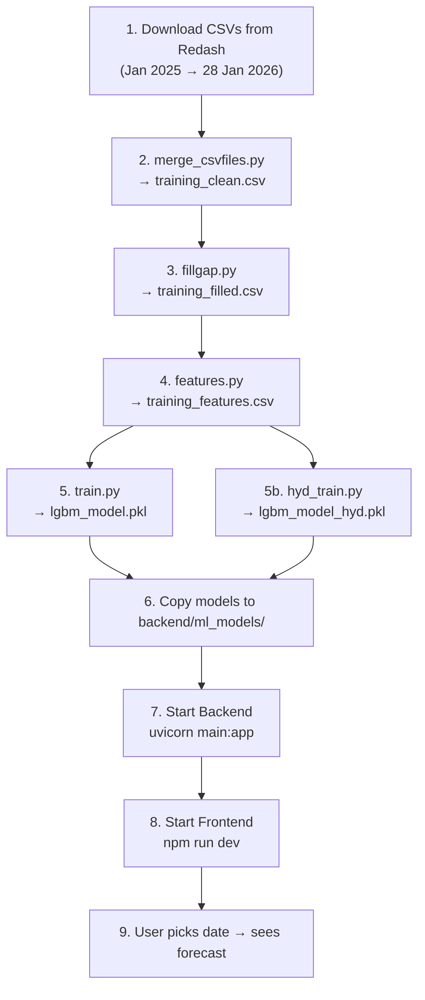

# Sid's Farm — Forecast Pipeline Workflow

## Overview



---

## Step-by-Step

### Step 1 — Download CSVs from Redash
You're doing this now. Place all monthly CSV files in:
```
D:\ML_Forecasting_Model\csv files\
├── jan2025.csv
├── feb2025.csv
├── mar2025.csv
├── ...
└── jan2026.csv
```

> [!IMPORTANT]
> All CSVs must have these columns: `target_date`, `city_cd`, `product_name`, `confirmed_qty`, `confirmed_orders`, `confirmed_value`, `subscription_type`

### Step 2 — Merge CSVs
```powershell
cd D:\ML_Forecasting_Model
python merge_csvfiles.py
```
**What it does:** Reads all CSVs → aggregates across `subscription_type` → renames `confirmed_qty → total_qty` → outputs `training_clean.csv`

**Verify output:**
```
Date range   : 2025-01-01 -> 2026-01-28
Cities       : ['BLR', 'HYD', 'PNQ', 'VGA']
```

### Step 3 — Fill Date Gaps
```powershell
python fillgap.py
```
**What it does:** Ensures every (city, product) has a row for every date → fills missing days with 0 → outputs `training_filled.csv`

### Step 4 — Generate Features
```powershell
python features.py
```
**What it does:** Creates lag features (`lag_1`, `lag_7`, etc.), rolling means, trend slopes, festival flags → outputs `training_features.csv`

> [!NOTE]
> This step takes ~30 seconds due to rolling slope computation.

### Step 5 — Train the Model
```powershell
python train.py
```
**What it does:** Trains LightGBM model → auto-splits last 30 days as test set → saves `lgbm_model.pkl`

**Expected output:**
```
MAE   : ~XX
MAPE  : ~XX%
Model saved : lgbm_model.pkl
```

### Step 5b — Train HYD-specific Model (Optional)
```powershell
python hyd_train.py
```
**What it does:** Trains a separate model for Hyderabad (better accuracy for HYD products)

### Step 6 — Copy Models to Backend
```powershell
copy lgbm_model.pkl backend\ml_models\
copy lgbm_model_hyd.pkl backend\ml_models\
copy training_clean.csv backend\ml_models\
```

> [!IMPORTANT]
> The backend also needs `procurement_plan.csv` in `backend/ml_models/`. If you don't have one, the backend will only serve subscription-based forecasts.

### Step 7 — Start Backend
```powershell
cd backend
pip install -r requirements.txt
uvicorn main:app --reload --port 8000
```
Verify: open `http://localhost:8000/health` → should return `{"status": "ok"}`

### Step 8 — Start Frontend
```powershell
cd frontend
npm install
npm run dev
```
Opens at `http://localhost:5173`

### Step 9 — Use the Dashboard
- Pick any date using the date picker
- Dashboard shows forecast for that date
- Subscription vs ML split is shown
- City and product breakdowns are displayed

---

## Quick Reference — Files Produced at Each Stage

| Step | Input | Output | Size (approx) |
|---|---|---|---|
| merge | `csv files/*.csv` | `training_clean.csv` | ~50K rows |
| fillgap | `training_clean.csv` | `training_filled.csv` | ~200K rows |
| features | `training_filled.csv` | `training_features.csv` | ~200K rows, 25+ cols |
| train | `training_features.csv` | `lgbm_model.pkl` | ~5 MB |
| train | `training_features.csv` | `test_predictions.csv` | ~5K rows |
